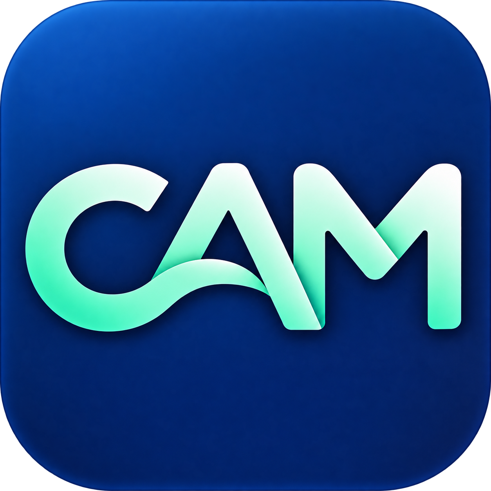

# Codex Account Manager



Codex Account Manager（简称 CAM）是一款为 macOS 菜单栏设计的 Codex 账号切换工具。启动时打开主窗口，关闭窗口后仍可通过菜单栏使用。菜单使用系统样式，跟随 macOS 浅色和深色外观；只提供 **官方账号**和**官方 API Key** 两组配置。

这是社区项目，并非 OpenAI 官方应用。

## 菜单和主面板

启动应用会打开主面板。点击菜单栏的账号切换图标，选择对应的二级菜单即可切换：

```text
打开主面板…
───────────────
官方账号       ›  当前账号 / 已保存的账号
官方 API Key   ›  已保存的 API Key
───────────────
退出 CAM
```

主面板是独立的 macOS 窗口，打开时会在程序坞显示 CAM 图标；左侧可以查看全部配置、官方账号和官方 API Key，左下角的设置进入独立的二级页面。当前登录直接显示在对应列表中并标记为“使用中”，不能重复切换或删除；切换前会自动备份当前凭据。默认关闭窗口后，程序坞图标会隐藏，应用仍留在菜单栏，可以随时再次打开。菜单里的勾选取决于从当前凭据识别到的账号；无法可靠识别时不会猜测。

账号名称优先使用登录凭据中提供的显示名称；未提供名称时显示邮箱。点击名称旁的编辑图标可设置本地别名，设置后优先显示别名；编辑当前登录的别名不会额外保存凭据。

官方账号卡片会根据 Codex 返回的会员类型，简化显示为 `Free`、`Plus`、`Pro` 或 `Team`，例如 `prolite` 显示为 `Pro`。当前账号读取 Codex 提供的登录信息，其他已保存账号显示上次获取的类型；无法归入这四类时显示 `Unknown`。实际订阅名称请以 ChatGPT 设置为准。会员发生变化后，可能需要在 Codex 重新登录才能更新。

官方账号卡片也会显示 Codex 返回的额度周期、剩余比例和重置时间，以及服务端提供的积分等信息。点击页面顶部的“刷新额度”可立即重新查询当前登录；未登录的已保存账号显示上次查到的数据和查询时间，尚未查过的账号需要切换后获取。为避免把不同工作区的额度混淆，当前登录必须能从文件凭据中识别身份；查询失败或服务端未返回数据时会显示额度不可用，不会当作零额度。API Key 的计费和限流与 ChatGPT 额度不同，这里不显示 API Key 余额。

设置分为“通用”“配置”和“关于”。通用页提供浅色、深色和跟随系统外观、开机自启、静默启动及关闭窗口时的行为；配置页提供 Codex 会话历史与配置目录、应用存储位置及诊断日志。开机自启使用 macOS 登录项，可能需要在系统设置中允许。界面目前使用简体中文。

界面布局参考 [CC Switch](https://github.com/farion1231/cc-switch) 的开源设计，配色与 CAM 图标保持一致，并适配浅色和深色外观。

### 面板快捷键

以下快捷键在主面板处于前台时使用：

| 快捷键 | 操作 |
| --- | --- |
| ⌘1 / ⌘2 / ⌘3 | 打开全部、官方账号、官方 API Key 页面 |
| ⌘, / ⌘[ | 打开设置 / 返回账号页面 |
| ⌘F | 聚焦账号搜索框 |
| ⌘N | 登录新账号；在 API Key 页面添加 API Key |
| ⌘R | 刷新当前状态 |
| 回车 / Esc | 在配置弹窗中保存 / 取消 |

搜索、新建和刷新快捷键在账号页面中可用，不会在其他应用中触发。

## 使用

CAM 管理的 Codex 默认登录在同一时刻使用一种方式：ChatGPT 账号或 OpenAI API Key。两类配置都可以保存，按需手动切换；添加后不会自动切换。

1. 在“打开主面板…”的列表中确认当前 Codex 登录；切换前 CAM 会自动备份当前登录。
2. 选择“登录新账号”或“添加 API Key”。登录账号时选择浏览器登录或设备代码登录，并完成 Codex 官方授权；成功后账号才会加入列表，不会自动切换当前 Codex 登录。如果浏览器已经登录其他账号，可以关闭自动打开浏览器，复制登录链接到另一个浏览器或无痕窗口。设备代码登录需要在 ChatGPT 安全设置或工作区权限中启用。已添加的账号不会重复添加，如需更新请使用该账号的“重新登录”。API Key 保存到本地凭据文件，保存时不验证有效性。
3. 从菜单栏的对应二级菜单选择配置。已添加的账号可直接切换；若凭据过期，可在主面板选择“重新登录”。重新登录会在独立的临时目录完成，并核对账号和工作区；选择了其他身份时不会替换所选账号或由 CAM 切换当前登录。登录时可以取消或复制登录链接。旧版留下的未登录占位配置仍会在首次切换时要求登录。
4. 如果 Codex 桌面版正在运行，系统弹窗会询问是否立即重启。选择“立即重启”会先退出 Codex，完成切换后重新打开；选择“稍后”会暂存选择，等 Codex 退出后再切换。当前打开的工作会被关闭，请自行处理进行中的任务。
5. 切换前需结束其他正在运行的 Codex CLI 会话。新打开的 CLI 与桌面版使用同一个 Codex Home 时才会读取相同的登录。项目设置和环境变量可能覆盖默认配置。

切换官方账号时，应用先将当前 `auth.json` 备份到该账号的本地凭据文件，再将所选账号的凭据恢复到 Codex Home 的 `auth.json`。API Key 使用 Codex 官方登录命令在独立临时目录生成凭据，再写入当前 Codex Home。Codex 使用过程中可能刷新令牌，因此每次切换前会重新保存当前凭据。切换失败时，应用只在当前凭据仍是本次写入的内容且原凭据存在时尝试恢复；如果无法确认恢复状态，界面会提示检查当前登录和配置。应用尝试检查运行中的 Codex 进程，但无法防止另一个进程在检查之后启动；切换期间请不要重新启动 Codex。

### 统一 Codex 会话历史

官方账号和官方 API Key 使用同一个 Codex Home 和服务商分组。如果当前配置是 CC Switch 产生的官方 `custom` 共享分组，应用会在核对它没有自定义地址、凭据或请求头之后，在切换时继续使用该分组；不依赖 CC Switch 运行，也不修改现有会话文件。设置中的“统一 Codex 会话历史”可控制是否在下次切换时保留该分组。

这不会自动迁移以前被分在其他服务商分组的会话，也不会合并不同账号的云端会话。若历史包含其他账号或服务产生的加密推理数据，切换后能否继续仍由 Codex 和服务端决定。

**当前版本只支持 Codex 的文件凭据存储模式。** 如果 `cli_auth_credentials_store` 为 `keyring`、`auto` 或 `ephemeral`，或者环境变量、组织登录限制、自定义 OpenAI 地址使当前状态无法安全识别，应用会停止切换，不自动修改这些设置。Codex 自身也可以使用系统凭据存储，详情见 [OpenAI 登录与凭据存储说明](https://developers.openai.com/codex/auth)。

## 安装与运行

需要 macOS 13 或更高版本，以及已安装的 Codex CLI。应用运行时不依赖 Python；从源码构建需要 Xcode。

如果已有旧版应用在运行，请先从菜单退出旧版，再构建和打开新版。

用 Xcode 打开 `CodexAccountManager.xcodeproj`，选择 `CodexAccountManager` 方案，即可构建和运行。也可以从终端构建：

```bash
sh scripts/build.sh
open "dist/CAM.app"
```

构建脚本默认生成支持 Apple Silicon 和 Intel 的通用应用，并使用本地临时签名。该构建没有经过 Apple 开发者签名或公证，不是可直接用于公开分发的签名安装包。

使用模拟数据预览菜单或主面板，不读取或修改真实登录：

```bash
"dist/CAM.app/Contents/MacOS/CodexAccountSwitcher" --demo
"dist/CAM.app/Contents/MacOS/CodexAccountSwitcher" --demo --dark
"dist/CAM.app/Contents/MacOS/CodexAccountSwitcher" --demo --demo-menu
```

预览可使用 `--light` 或 `--dark`；正常运行时默认跟随系统外观，也可在通用设置中选择。

CAM 图标源文件位于 [`assets/cam-app-icon-trimmed.png`](assets/cam-app-icon-trimmed.png)。修改后可运行 `sh scripts/build-icon.sh` 重新生成 macOS 应用图标；此脚本需要 Python 3。

## 数据与安全

- 名称、账号邮箱、会员类型、上次查询到的额度和用于识别当前配置的指纹默认保存在 `~/.cam/profiles.json`。每个账号的凭据单独保存在同目录 `credentials/` 下的 JSON 文件中；ChatGPT 凭据使用 Codex 的 `auth.json` 内容，API Key 使用 `OPENAI_API_KEY` 字段。凭据目录权限为 `0700`，文件权限为 `0600`；凭据没有加密，请妥善保护这些文件。
- 可以在设置中更换应用配置目录。配置和凭据会复制到新目录并保留原文件；目标已有不同配置或凭据时不会覆盖。旧日志留在原目录，新日志写入当前目录。目录选择和界面选项由 macOS 的应用偏好设置保存。
- 启动时自动读取 CAM 进程环境中的 `CODEX_HOME`，未设置时使用 `~/.codex`，也可以在设置中手动指定。终端中单独设置的环境变量不一定会传给从 Finder 启动的 CAM。
- 应用诊断日志保存在应用存储目录下的 `diagnostics.log`，可在设置中启用、停用、调整级别或打开。日志只包含固定的事件和错误类别，不写入账号、密钥、授权链接或会话内容。
- 当前 Codex 登录仍由 Codex 自己管理：文件模式默认位于 `~/.codex/auth.json`，文件包含敏感令牌。添加账号时使用独立的私有临时 Codex 目录，完成或取消后会清理；意外退出时系统临时目录中可能残留待清理的文件。不要把凭据提交到 Git、贴到聊天中或分享给他人。
- 恢复 ChatGPT 账号依赖 Codex 当前的凭据文件格式，不是 OpenAI 提供的多账号切换接口。Codex 更新可能改变该格式或行为；如果凭据失效，需要重新使用官方登录。真实账号和桌面版的完整切换与重启流程仍需在目标环境验证。
- 官方账号切换默认使用 `openai` 服务商；已启用统一历史且当前共享分组通过官方配置检查时，会保留该分组。切换不会清空默认模型。若 Codex 的 OpenAI 地址已自定义，应用不会将其默认为官方配置，也不会替你覆盖。
- 旧版本的第三方服务配置不会出现在新菜单中，但其本地数据与凭据助手仍保留，以免破坏已有配置。

## 开发与验证

在 Xcode 中选择 `CodexAccountManager` 方案并执行测试，或运行：

```bash
xcodebuild -project CodexAccountManager.xcodeproj -scheme CodexAccountManager -destination 'platform=macOS' test
```

测试使用临时 Codex Home、模拟凭据和本机模拟服务。测试夹具使用 Python；应用运行时不需要 Python。

## 许可证

[MIT](LICENSE)
