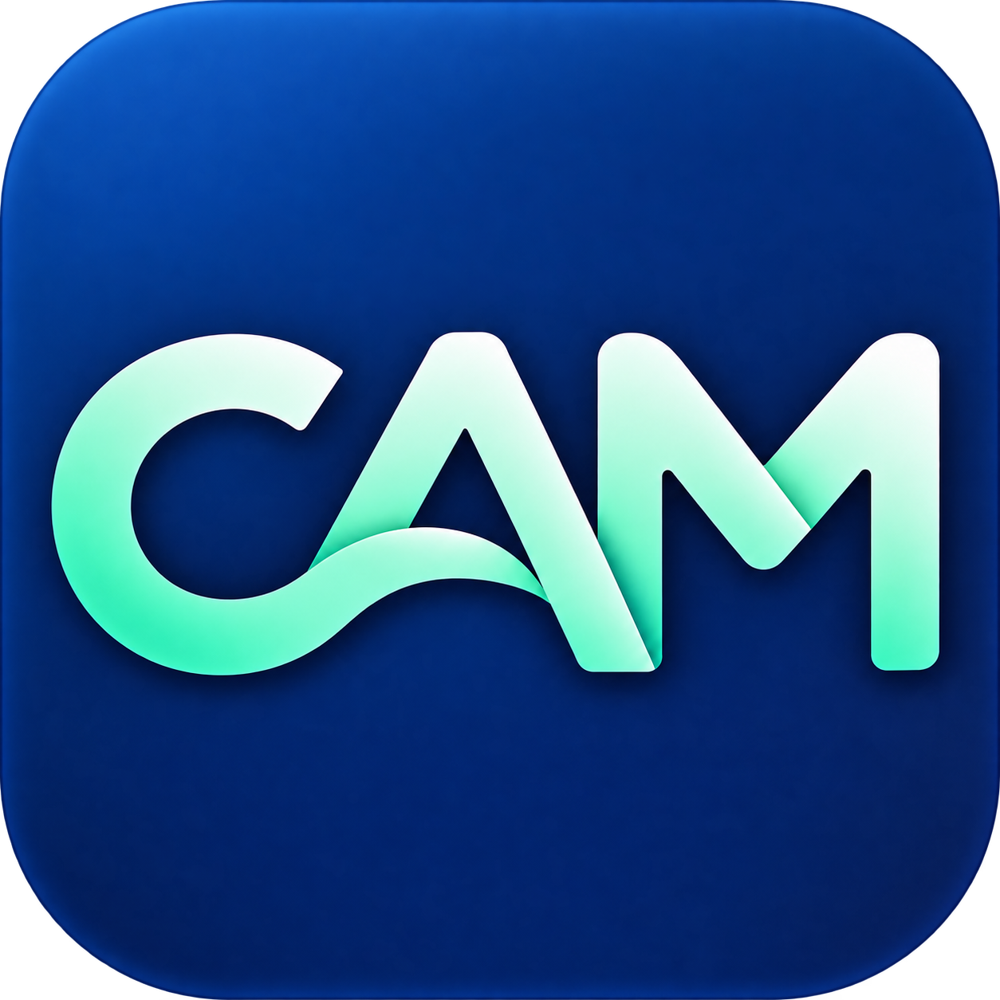
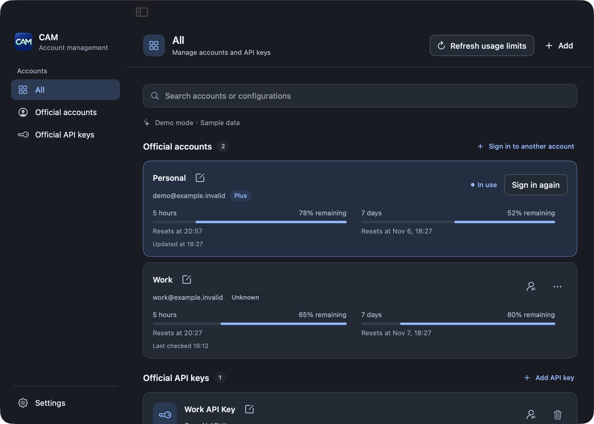

<p align="center"><a href="README.md">简体中文</a> · <strong>English</strong></p>

<p align="center">
  
</p>

<h1 align="center">Codex Account Manager</h1>

<p align="center">Manage and switch Codex accounts and API keys on macOS.</p>

<p align="center"><a href="https://starrain.github.io/Codex-Account-Manager/en/">Website</a> · <a href="https://github.com/StarRain/Codex-Account-Manager/releases/latest">Download the latest release</a></p>

<p align="center">
  
  
  
  <a href="LICENSE"></a>
</p>

Codex Account Manager (CAM) is a local macOS app for managing ChatGPT accounts and OpenAI API keys and viewing the account usage limits returned by Codex. It provides a menu bar panel and a standalone main panel.

> The current version requires Codex to use file-based credential storage and manages only official accounts and official API keys.

## Screenshots



The screenshot is from demo mode; the accounts and usage figures are sample data.

## Features

### Accounts and API keys

- Sign in to ChatGPT through a browser or device code; new account sign-ins use an isolated temporary Codex directory.
- Add OpenAI API keys and switch between saved accounts and keys.
- See the active login as “In use”; CAM backs up the current file credentials before switching.
- Show the name supplied by the account when available, otherwise the email address; local aliases are also supported.
- Verify the account and workspace identity when signing in again to a saved account.

### Plans and usage

- Group plan types returned by Codex as `Free`, `Plus`, `Pro`, `Team`, or `Unknown`; refer to ChatGPT settings for the actual subscription name.
- Show usage windows, remaining percentages, reset times, and credits returned by the service.
- Manually refresh the active login's usage; other accounts show their last retrieved results.
- Configure a separate Admin API key to show monthly API costs, input/output tokens, cached input tokens, and generation requests. Add a project ID to also view model rate limits.
- API key billing is separate from ChatGPT usage; CAM does not display API key balances.

### Experience

- Switch configurations from the menu bar or main panel; the Dock icon is shown while the main window is open.
- Choose light, dark, or system appearance, launch at login, and silent startup.
- Search accounts, use panel keyboard shortcuts, and inspect local diagnostic logs.
- Account and API key cards show a compact overview with expandable details; refresh actions display a loading indicator.
- Notifications appear at the top and dismiss automatically; a separate card keeps the pending switch target visible.
- Configure the Codex directory, app data directory, and session history grouping.
- Manually check for the latest stable GitHub release from About and open its download page.

## How it works

```text
Codex Account Manager
  ├─ Sign in to a new account: temporary Codex directory → official sign-in → CAM local credentials
  ├─ Back up the current login: Codex Home/auth.json → CAM local credentials
  └─ Switch login: selected credentials → Codex Home/auth.json
```

Codex may refresh tokens during use. Before switching, CAM saves the current file credentials again. Account login and API key login are mutually exclusive at any given time; adding a configuration does not switch to it automatically.

If a switch fails, CAM attempts to restore the previous credentials only when it can confirm that the current file is the one it wrote and that the original credentials exist. End other Codex CLI sessions before switching, and do not restart Codex during the switch.

## Installation

### Requirements

- macOS 13 or later.
- The Codex CLI must already be installed.
- Xcode is required to build from source; Python is not required to run the app.

### Install a release

Download the DMG from [GitHub Releases](https://github.com/StarRain/Codex-Account-Manager/releases/latest), open it, and drag `Codex Account Manager.app` into Applications.

The release uses an ad-hoc signature and is not Apple developer-signed or notarized. Before replacing an older version, quit CAM from the menu bar.

If macOS says the developer cannot be verified the first time you open the app, confirm that the download is from a trusted source, then choose one of the following:

1. Try to open the app, then select “Open Anyway” for CAM under System Settings → Privacy & Security. See [Apple's guidance](https://support.apple.com/en-us/102445).
2. After moving the app to Applications, run the following in Terminal:

   ```bash
   xattr -dr com.apple.quarantine "/Applications/Codex Account Manager.app"
   open "/Applications/Codex Account Manager.app"
   ```

The command removes the app's download quarantine flag and skips the corresponding first-launch origin check; it does not add an Apple developer signature or notarization. If the app is installed elsewhere, replace the path with its actual location.

### Build from source

```bash
git clone https://github.com/StarRain/Codex-Account-Manager.git
cd Codex-Account-Manager
sh scripts/build.sh
open "dist/Codex Account Manager.app"
```

Alternatively, open `CodexAccountManager.xcodeproj` in Xcode and build the `CodexAccountManager` scheme.

After installing `create-dmg` (`brew install create-dmg`), run `sh scripts/build-dmg.sh` to package the built app as a DMG.

The build script creates an ad-hoc signed app that is not Apple developer-signed or notarized. If an older version of CAM is running, quit it from the menu bar before opening the new build.

## Usage

1. Open the main panel to see the account or API key currently in use.
2. Choose “Sign in to another account” or “Add API key” and follow the prompts. API keys are not validated when saved.
3. Choose a saved configuration in the main panel or menu bar. CAM backs up the current login before switching.
4. If Codex desktop is running, choose whether to restart it now or switch after it exits.
5. Select “Refresh usage limits” to query the active ChatGPT login again; use “Sign in again” for a saved account whose credentials have expired.
6. Expand an API key card, select “Configure”, enter an Admin API key, then select “Save and fetch”. Project and API key IDs are optional; leaving them blank explicitly shows organization-wide totals. A regular model API key cannot replace the Admin API key.

If your browser is signed in to another account, turn off automatic browser opening and copy the sign-in link to another browser or a private window. Device-code login must be enabled in ChatGPT security settings or workspace permissions.

API statistics cover the current UTC calendar month. Costs come from the official Costs API, tokens and requests from Completions Usage, and project limits from Project Rate Limits; reporting can be delayed. Failed refreshes retain and label previous results from the current month, without carrying last month's totals into a new month. Model rate limits are configured ceilings, not remaining capacity. Reconfigure reporting after replacing a model API key.

### Panel shortcuts

| Shortcut | Action |
| --- | --- |
| `⌘1` / `⌘2` / `⌘3` | Open All, Official accounts, or Official API keys |
| `⌘,` / `⌘[` | Open Settings / return to accounts |
| `⌘F` | Focus account search |
| `⌘N` | Sign in to another account; add an API key on the API keys page |
| `⌘R` | Refresh the current status |
| `⌘W` / `⌘M` | Close / minimize the main panel |
| `⌘A` / `⌘C` / `⌘V` / `⌘X` | Select all / copy / paste / cut |
| `Return` / `Esc` | Save / cancel in configuration dialogs |

Search, add, and refresh shortcuts apply only on the relevant CAM panel pages.

### Shared Codex session history

Accounts and API keys use the same Codex Home. When “Unify Codex session history” is enabled, CAM preserves the current official shared provider grouping when the required conditions are met; it does not modify existing session files.

This setting does not migrate older sessions from other provider groups or merge cloud conversations across accounts.

## Data and security

- App data defaults to `~/.cam`: account information is in `profiles.json`, credentials are in `credentials/`, and diagnostic logs are in `diagnostics.log`.
- Credential files are unencrypted; the credentials directory uses `0700` permissions and files use `0600`. Do not commit or share them.
- The reporting Admin API key is stored separately in `credentials/<profile ID>.admin.json`, never in Codex login files, and is sent only to read-only endpoints on the official `api.openai.com` host. Removing reporting configuration deletes its Admin API key; changing the app data directory copies it with the other credentials.
- Codex file credentials default to `~/.codex/auth.json`. On startup, CAM reads `CODEX_HOME` from its environment; the directory can also be set manually.
- An app launched from Finder may not inherit environment variables set only in a terminal. The desktop app and CLI must use the same Codex Home to share a login.
- Account sign-in uses a temporary directory and cleans it up after completion or cancellation; files may remain in the system temporary directory after an abnormal exit.
- `keyring`, `auto`, and `ephemeral` credential modes, as well as environment variables, organization restrictions, or OpenAI addresses that cannot be identified safely, block switching. See [OpenAI's authentication and credential storage documentation](https://developers.openai.com/codex/auth).
- CAM relies on Codex's current credential file format; it is not an OpenAI-provided multi-account switching API. The full switching and restart flow with real accounts and the desktop app still needs validation in the target environment.

## Development and verification

Run the tests:

```bash
xcodebuild -project CodexAccountManager.xcodeproj -scheme CodexAccountManager -destination 'platform=macOS' test
```

Preview with sample data without reading or modifying real logins:

```bash
open -n "dist/Codex Account Manager.app" --args --demo
open -n "dist/Codex Account Manager.app" --args --demo --dark
```

Tests use temporary Codex Homes, mock credentials, and a local mock server. Test fixtures and the icon generation script require Python 3; the icon source is [`assets/cam-app-icon-trimmed.png`](assets/cam-app-icon-trimmed.png).

## Related project

- [Codex](https://github.com/openai/codex): OpenAI's Codex tool.

## Contributing

Please use [Issues](https://github.com/StarRain/Codex-Account-Manager/issues) or pull requests to contribute. For changes to account switching, credential storage, or sign-in flows, include how the change was verified.

## License

This project is licensed under the [MIT License](LICENSE).

## Disclaimer

CAM is a community project and is not affiliated with or endorsed by OpenAI.
